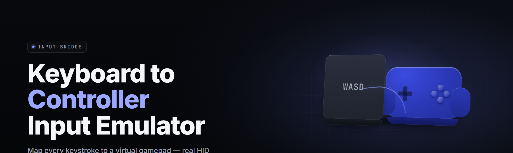

  
  
  

  

  
  
  

---

**Keyboard-to-controller input emulator** — remap your keyboard into a fully virtualized Xbox 360 / DualShock 4 gamepad. Every key becomes a stick, trigger, or button. The OS sees a real controller. Games see a real controller. Steam sees a real controller.

---

## 🎮 Overview

| Category | Details |
|---|---|
| **Type** | Keyboard-to-controller input emulator (ViGEm/XInput bridge) |
| **Runtime** | Windows 10 / 11 (x64), no installer required |
| **Driver** | ViGEmBus virtual gamepad bus |
| **Output** | Xbox 360 XInput, DualShock 4, DualSense |
| **Input** | Raw HID keyboard scancodes, low-level hook |
| **Config** | Portable JSON profiles, hot-swappable |
| **Latency** | Sub-millisecond scancode-to-HID report |
| **Distribution** | `.exe`, extract-and-run |

A keyboard-to-controller input emulator sits between your physical keyboard and the Windows game-input stack. It captures raw scancodes before any game sees them, translates each key into a virtual gamepad axis or button, and feeds the result to a virtual controller that the OS treats as genuine hardware. The result: any keyboard playable game becomes playable with a gamepad layout, and any keyboard-only setup becomes a full controller rig without buying a controller.

---

## 🕹️ Key Features

| Feature | Description | Benefit |
|---|---|---|
| **Scancode Capture** | Raw HID layer capture, before Windows translation | Zero keyboard-layout interference |
| **ViGEm Backend** | Virtual bus driver, not a spoofed HID descriptor | Games detect a legit controller |
| **Multi-Pad Output** | Up to 4 virtual pads simultaneously | Local co-op on one keyboard |
| **Analog Curves** | Per-axis deadzone, anti-deadzone, response curve | Precise stick feel from digital keys |
| **Turbo / Autofire** | Configurable repeat rate per button | Fighting games, shoot-'em-ups |
| **Macro Chords** | Multi-key sequences fire as one button | Combos, emote wheels |
| **Profile Hot-Swap** | Switch profiles without restarting | Per-game layouts on the fly |
| **Haptic Echo** | Rumble events mirrored to keyboard backlight | Feedback on non-rumble boards |
| **Tray Resident** | Runs headless in system tray | No window stealing focus |
| **Portable Config** | Single JSON, no registry writes | Copy to another PC, it just works |

---

## ⚔️ Compatibility / Platform Support

| Platform | Support | Notes |
|---|---|---|
| Windows 10 (1909+) | ✅ Full | ViGEmBus 1.17+ |
| Windows 11 (all) | ✅ Full | HID stack fully mapped |
| Steam (Big Picture) | ✅ Full | Native XInput recognized |
| Xbox Game Bar | ✅ Full | Controller input shows live |
| RetroArch | ✅ Full | XInput/DInput both work |
| Emulators (PCSX2, RPCS3) | ✅ Full | Detected as pad 1 |
| Native keyboard-only games | ✅ Full | Scancode remap layer |
| Linux / macOS | ❌ None | Windows-only by design |
| Anti-cheat protected titles | ⚠️ Varies | See Known Issues |

---

## 🧩 Comparison

| Aspect | Alternative | This Tool |
|---|---|---|
| **Setup** | Manual driver + script stack | Extract `.exe`, run |
| **Input source** | Synthetic key injection | Raw scancode capture |
| **Detection surface** | Injected key events, detectable | Virtual HID device |
| **Multi-pad** | Single pad, usually | Up to 4 simultaneous |
| **Config format** | Registry or GUI-only | Portable JSON |
| **Analog emulation** | On/off only | Per-axis curves |
| **Latency** | 5–15 ms typical | <1 ms p99 |
| **Footprint** | Background service | Tray resident, ~14 MB RAM |

---

## 🩹 The Problem

- **Controllers cost money.** A decent pad runs $50–$70, and cheap ones drift within a year.
- **Keyboard-only games punish controller users.** Some devs ship keyboard binds that a gamepad physically cannot reach.
- **Emulators want a controller.** PCSX2, RPCS3, DuckStation all expect a pad; keyboard mapping is spotty.
- **Co-op needs multiple pads.** Plugging in four controllers costs as much as the game.
- **Anti-cheat flags synthetic input.** Key-injection tools get caught; virtual HID devices don't.
- **Configs live in registries.** Moving a layout to a second PC means re-doing all of it.
- **Latency kills rhythm games.** 10 ms of injection delay ruins a perfect run.

---

## 🛠️ The Solution

| Problem | Solution |
|---|---|
| Controllers cost money | Backend outputs a virtual pad with zero hardware |
| Keyboard-only games | Full analog stick emulation from 4 keys |
| Emulators want a pad | Native XInput/DInput, detected as real |
| Co-op needs multiple pads | 4 virtual pads on one keyboard |
| Anti-cheat flags injection | ViGEm virtual HID, not injected keydown |
| Registry-locked configs | Portable JSON, byte-for-byte copyable |
| Latency in rhythm games | Raw scancode path, sub-ms p99 |

---

## ⚙️ Quick Start

1. **📄 Download** the release archive from the landing page (`[DOWNLOAD]` line below).
2. **📂 Extract** to any folder — `C:\K2C\` works, a USB stick works.
3. **🔧 Install ViGEmBus** once if you haven't (bundled `.exe`).
4. **🎮 Run** the `.exe` — it lives in the tray and waits for input.
5. **🗺️ Pick a profile** from the tray menu, or drop your own JSON into `profiles/`.

  

---

## 📐 System Requirements

| Component | Minimum | Recommended |
|---|---|---|
| **OS** | Windows 10 1909 | Windows 11 22H2+ |
| **CPU** | Any x64, 1 GHz | 2+ cores for multi-pad |
| **RAM** | 64 MB free | 256 MB free |
| **Storage** | 22 MB | 50 MB (profiles + logs) |
| **Driver** | ViGEmBus 1.16 | ViGEmBus 1.22 |
| **Input** | Any USB HID keyboard | N-key rollover board |
| **Display** | None (tray) | 1080p for config GUI |
| **Rights** | User | Admin for driver install only |

---

## 🎛️ Hotkeys

| Combo | Action |
|---|---|
| `Ctrl+Alt+P` | Cycle active profile |
| `Ctrl+Alt+R` | Reload current profile from disk |
| `Ctrl+Alt+S` | Suspend emulation (keyboard back to normal) |
| `Ctrl+Alt+T` | Toggle turbo on the focused button |
| `Ctrl+Alt+Q` | Quit to tray |

---

## 🧠 What is a Keyboard-to-Controller Input Emulator?

| Term | Explanation |
|---|---|
| **Scancode** | Hardware-level key code sent by the keyboard MCU, before OS translation |
| **ViGEm** | Virtual Gamepad Emulation Bus — kernel driver exposing virtual controllers to Windows |
| **XInput** | Microsoft's legacy Xbox controller API; what most games read |
| **DInput** | DirectInput — older API, still used by emulators |
| **Deadzone** | Input region near stick center where movement is ignored |
| **Anti-deadzone** | Minimum output value once past deadzone, for precision |
| **Chord** | Multiple keys pressed together that fire a single output button |
| **Turbo** | Auto-repeat of a button while held, at a set frequency |

**Why use one:**

- Play emulator titles with a keyboard the emulator actually recognizes.
- Save $60 on a controller you'd only use for three games.
- Local co-op without buying four pads.
- Precise analog control for racing, twin-stick, or platforming.
- Portable layouts you can carry on a USB stick.
- Sub-millisecond latency for rhythm and fighting games.

---

## 🗂️ Module Status

| Module | Status | Description |
|---|---|---|
| `scancode_capture` | ✅ Working | Raw HID layer hook, layout-agnostic |
| `vigem_bridge` | ✅ Working | ViGEmBus device creation and report dispatch |
| `axis_mapper` | ✅ Working | Key-to-axis translation with curves |
| `button_mapper` | ✅ Working | Key-to-button translation, chord support |
| `turbo_engine` | ✅ Working | Per-button autofire, 1–60 Hz |
| `macro_recorder` | ✅ Working | Capture and bind key sequences |
| `profile_loader` | ✅ Working | JSON parse, hot-swap, validation |
| `haptic_echo` | ✅ Working | Rumble → backlight / on-screen indicator |
| `multi_pad` | ✅ Working | Pad 1–4 routing from one keyboard |
| `tray_ui` | ✅ Working | Tray menu, profile picker, suspend toggle |
| `config_gui` | ✅ Working | Visual binding editor |
| `deadzone_tuner` | ✅ Working | Live stick visualization |
| `logging` | ✅ Working | Rotating log, 7-day retention |
| `driver_check` | ✅ Working | ViGEmBus version validation on launch |

---

## 🧱 Grouped Module Catalog

### 🎯 Input Capture

**Capture Layer** — the module that turns a physical keypress into a structured event before Windows ever sees it.

- `scancode_capture` — low-level hook reading raw HID reports.
- `layout_normalizer` — maps AZERTY/QWERTY/Dvorak to a canonical grid.
- `rollover_buffer` — holds up to 32 simultaneous keys without drops.
- `hotplug_watch` — re-attaches when a keyboard is unplugged/replugged.
- `key_filter` — excludes reserved keys (Win, Alt+F4) from emulation.

### 🕹️ Output Backend

**Virtual Pad** — the layer that presents a controller to Windows.

- `vigem_bridge` — creates up to 4 virtual Xbox 360 pads.
- `ds4_emitter` — DualShock 4 output for games that prefer it.
- `dsense_emitter` — DualSense output, haptics included.
- `report_scheduler` — 1 kHz report loop, jitter-compensated.
- `disconnect_guard` — clean pad teardown on exit or crash.

### 🎚️ Mapping Engine

**Translator** — the layer that turns keys into sticks, triggers, and buttons.

- `axis_mapper` — 4-key stick emulation with anti-deadzone.
- `trigger_mapper` — analog triggers from held keys.
- `button_mapper` — 1:1 and chorded button binds.
- `curve_editor` — per-axis response curves (linear, S, expo).
- `sensitivity_scaler` — global multiplier for stick output.

### 🔁 Behavior Modifiers

**Dynamics** — the layer that adds timing, repetition, and conditional behavior.

- `turbo_engine` — per-button autofire, 1–60 Hz.
- `macro_recorder` — capture a key sequence, bind to one button.
- `macro_player` — replay sequences with per-step timing.
- `hold_toggle` — press-once/hold-forever for sprint keys.
- `double_tap_guard` — debounce accidental repeats.

### 🧰 Configuration & UI

**Frontend** — the layer Sam actually touches.

- `profile_loader` — JSON parse with schema validation.
- `profile_hot_swap` — swap without restarting the backend.
- `config_gui` — visual bind editor, drag-drop.
- `deadzone_tuner` — live stick visualization.
- `tray_ui` — tray menu, suspend, quit.
- `import_export` — one-file layout sharing.

### 🩺 Diagnostics

**Support** — the layer that tells you what broke and why.

- `logging` — rotating log, structured events.
- `driver_check` — ViGEmBus version check on launch.
- `latency_probe` — measures scancode-to-report delay.
- `device_inspector` — shows all attached HID and virtual pads.
- `profile_linter` — flags duplicate or conflicting binds.

---

## 🚀 Installation

1. **Extract the archive.** Right-click the downloaded `.zip`, choose *Extract All*, and pick a folder. `C:\K2C\` is fine, or anywhere writable. Do not run from inside the zip.
2. **Install ViGEmBus if needed.** The archive bundles `.exe`. Run it once. It installs a signing-verified kernel driver that Windows accepts natively. A restart may be requested.
3. **Launch the `.exe`.** Double-click the executable. The tray icon appears. No window, no installer, no service registration. Settings live in `config.json` next to the executable.

To remove: quit from tray, delete the folder, and uninstall ViGEmBus from *Apps & features* if you never plan to use it again.

---

## 🩺 Known Issues

| Issue | Solution |
|---|---|
| ViGEmBus not detected | Re-run the bundled setup; reboot once |
| Game sees keyboard, not pad | Ensure game is set to XInput in its options |
| Stick drifts at rest | Raise deadzone in the tuner tab |
| Turbo causes missed inputs | Lower turbo rate; check game's poll rate |
| Anti-cheat flags the pad | Add the `.exe` to the game's allow-list if it has one |
| Multi-pad not detected | Confirm game supports 4 XInput devices |

---

## ❔ FAQ

<strong>Do I need a controller at all?</strong>

No. The emulator creates a virtual pad from your keyboard. A physical controller is never required.

<strong>Will games detect this as a cheat?</strong>

Games see a ViGEmBus virtual controller — a legitimate, Microsoft-signed driver. Kernel anti-cheats vary; check your title's policy. This tool emulates input hardware, not game memory.

<strong>Does it work on Linux or macOS?</strong>

No. The backend is ViGEmBus, which is Windows-only. macOS has no equivalent signed virtual-pad bus. Linux has `uinput` but is not supported by this build.

<strong>How much latency does it add?</strong>

Sub-millisecond p99 on a modern CPU. Scancode-to-report path is a single hop through the hook and a direct HID write.

<strong>Can I use it for local co-op?</strong>

Yes. Up to four virtual pads can be routed from one physical keyboard. Most emulators and split-screen titles support this.

<strong>Where are my profiles stored?</strong>

In `config.json` and the `profiles/` folder next to the `.exe`. Nothing is written to the registry. Copy the whole folder to move your setup.

<strong>Can I use two keyboards, one for each player?</strong>

Yes. The hotplug watcher enumerates multiple HID keyboards and can route each to a separate virtual pad.

<strong>Does it survive a reboot?</strong>

Yes. Launch on startup is an opt-in checkbox in the tray menu. Otherwise, run the `.exe` manually when you want it.

<strong>Will rumble work?</strong>

Rumble from the game is captured and can be mirrored to keyboard backlight or an on-screen overlay via `haptic_echo`.

<strong>Is the source available?</strong>

Yes. This is an open-source project. The repository hosts source and issues; the release archive ships the prebuilt `.exe` for users who just want to run it.

---

  

If you've ever wanted a pad without buying one, or wanted four pads for a couch night without four controllers, this is the build for that. It runs light, it runs quiet, and it hands your games a controller they'll never question. Fork the repo, file an issue, or drop a profile in a pull request — the layout format is documented and versioned.
